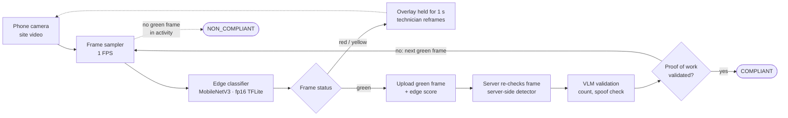

# Trustworthy Interest of Frame Extraction from Real Time Video Evidence on a ₹12,000 Phone

**What broke when we moved an object detector from a laptop to a low-end Android phone, and how we made its output trustworthy.**

*Shruti Kukreja · Applied AI Engineer · November 2026*

> This write-up describes research and engineering work done for a large Indian telecom infrastructure operator. Client names, code, model weights and site images are not published. All numbers are from our own measurements.

---

## TL;DR

- **Converting a model isn't enough. The pixels have to match too.** Changing only the image resize method moved detection scores by up to **0.15**. Only the resize that exactly matched the training pipeline passed **52 / 52** parity frames. Bilinear passed 18 / 52.
- We wrote a **bit-exact Kotlin port** of the training-time preprocessing. On the phone, **0 of 786,432** input values differed from the laptop, and on-device outputs matched the laptop (IoU 1.000, score difference < 0.0001).
- A 118 MB transformer detector (RF-DETR Small) ran at **~0.6 FPS** on a Snapdragon 730G. That result drove a split: a **lightweight CNN classification model on the phone** for live guidance and **heavier models on the server** for the final decision.
- **The server doesn't trust the phone.** It recomputes the capture gate from raw detections and runs a VLM over the captured gate frame, including a screen-recapture spoof check, before marking anything compliant.

---

## 1. The problem

Field engineers carry out preventive maintenance at telecom tower sites, on the order of **2 lakh (200,000) site visits a month**. Each visit needs photo or video evidence of specific equipment, such as rectifier modules inside a power cabinet or surge protection devices. Today these evidences are checked by hand.

The goal: **the phone confirms that the right equipment was properly captured while the engineer is still on site, and the system decides afterwards whether the proof of work can be trusted.**

### Constraints

| Constraint | Value |
|---|---|
| Device | ₹10,000–15,000 Android phones (test device: Realme X2, Snapdragon 730G) |
| Live guidance latency | Box plus guidance within 1–2 s |
| Accuracy | False approvals are costly, so we accept slower inference for higher accuracy |
| Licensing | Permissive licences only (no AGPL, no paid licences) |
| Hardware | Must run on any CPU, GPU or NPU on non-Apple Android devices |
| Adversaries | Some users may try to game the system (old footage, filming a screen) |
| Data privacy | Site data stays in India (data residency); no third-party provider may train on or retain our videos, frames or prompts |

---

## 2. Research questions

1. **Parity:** Does a model converted for mobile behave *identically* on the phone? If not, where does the drift come from?
2. **Latency:** What frame rate can a low-end phone actually sustain, and which runtime gets there?
3. **"Detected" vs "properly captured":** What rule turns noisy per-frame detections into a reliable "this item is covered" signal?
4. **Trust:** How do we keep a modified app or a spoofed video from producing a compliant result?

---

## 3. System overview

## 3. System overview

The system has two stages: a fast, lightweight check on the phone that **guides** the technician, and a slower, more accurate check on the server that **decides**.

1. **Capture.** The technician records a video of the site equipment.
2. **Live guidance (phone).** An on-device classification model scores one frame per second as 🟢 **green** (compliant), 🟡 **yellow** (not sure) or 🔴 **red** (non-compliant). The result is shown on every video frame in that second, so the overlay stays steady while the model runs only once a second. On yellow or red, the technician adjusts the framing until the status turns green.
3. **Validation (server).** Each green frame is sent to the backend with its edge score. The server re-checks the frame with its own detector, then a vision-language model (VLM) validates it, for example counting modules and checking the frame wasn't filmed from a screen. The phone keeps sending green frames until one is validated.
4. **Decision.** The activity is **compliant** once the backend validates a frame. If the edge model finds no compliant frame anywhere in the activity, it is marked **non-compliant**.

**Why this design**

- **Runs on low-end phones:** at 1 FPS, a lightweight model fits the compute, battery and heat budget of a ₹10,000–15,000 phone.
- **The phone guides; it never approves:** the server re-checks every green frame instead of trusting the phone's score, so a wrong or tampered edge result can't approve an activity by itself.
- **Sends little data:** only green frames are uploaded rather than the full video, which keeps uploads small on weak mobile networks.

---

## 4. Experiments and findings

### 4.1 Laptop-to-phone parity: preprocessing details move results a lot

**Question:** After exporting the detector (ONNX → ORT), does the phone give the same results as the laptop?

**Setup:** We fed the same decoded pixels to both pipelines and compared detections box by box. Pass criteria: same class, IoU ≥ 0.9, |Δscore| ≤ 0.02, and the top-10 raw queries within 0.02.

**Finding 1: the resize method alone changes the output.**

| Resize method | Frames passing parity (IoU ≥ 0.99, \|Δscore\| ≤ 0.01) |
|---|---|
| PIL bicubic (matches training) | **52 / 52** |
| PIL bilinear | 18 / 52 |
| OpenCV linear | 17 / 52 |

On one image the score dropped from **0.867 to 0.721** when we changed only the interpolation method.

**What we did:** We wrote a bit-exact Kotlin port of Pillow's bicubic resize and a JVM unit test that compares the phone's input tensor with the laptop's.

| Check | Result |
|---|---|
| Kotlin preprocessing vs laptop tensor | **0 of 786,432 values differ** |
| `.onnx` vs `.ort` on laptop | max score diff 6e-5, max box diff 1.1e-3 |
| On-device (Realme X2), CPU 4 threads | **PASS**: IoU 1.000, score diff < 0.0001 on every test image |
| On-device (Realme X2), XNNPACK | **PASS** |

**Takeaway:** treat preprocessing as part of the model. Store it with the model version, and require a parity test before any new runtime or device is allowed.

### 4.2 Hidden label and model behaviour

The parity work also showed problems that accuracy metrics alone would have missed:

- The model outputs **4 class logits but the label file has 3 names**. On our test set, one index never fired, which suggests an unused trailing slot. The names of the other indices still needed a labelled check.
- One class (`rm_view`) fired at **~0.96 confidence on pure noise and gradients**, with a near full-frame box. It behaves like a scene-level label rather than an object. We hid it from the overlay by default and kept it in the parity tests.

**Takeaway:** a confident output isn't necessarily a meaningful one. We moved to an explicit class map, and in production the system refuses any map that hasn't been verified.

### 4.3 Latency: the fastest hardware isn't always fastest

| Setting | Result |
|---|---|
| MobileNet v3 Small (FP16, 5 MB), Realme X2 | **~1 FPS** |
| Same model, ARM emulator on Mac, CPU 4 threads | ~100 ms inference + 38 ms preprocessing |
| Mac server, rectifier model, CPU | p50 ≈ **85 ms** |
| Mac server, rectifier model, CoreML (GPU/Neural Engine) | p50 ≈ **137 ms** (slower) |
| Mac server, SPD model, CoreML | **Fails** |
| Batching on CPU (batch 4 vs 1) | **+20%** cost per image |

On Android, ONNX Runtime has no generic GPU backend. NNAPI is the only route to the GPU or DSP, so we benchmarked CPU (2, 4 and 8 threads), XNNPACK, NNAPI and NNAPI FP16 side by side.

**Decision:** split the work by job.
- **On the phone:** a lightweight CNN (MobileNetV3, under 10 MB, float16 TFLite) for live guidance at about 1 frame per second, giving a box, a good/bad frame signal and directions (move closer or back, too blurry, not frontal).
- **On the server:** the heavier, more accurate detectors and the VLM for the final decision.

### 4.4 Moving live inference onto the phone

**Why we moved it.** In the first design, each phone streamed frames at 6 FPS to a shared detector server. We measured how that server behaved as more phones joined:

| Phones streaming | Achieved FPS / phone | Server p50 / p95 (ms) |
|---|---|---|
| 1 | 6.0 | 85 / 94 |
| 2 | 5.8 | 247 / 327 |
| 3 | 3.8 | 412 / 477 |

Latency roughly quadrupled with just three phones. At 2 lakh site visits a month, a server-side live loop would need a GPU fleet sized for peak load, and live guidance would fail whenever the mobile network did. That data drove the switch to a **MobileNetV3 classifier running on the phone**.

**What changes.** Live guidance no longer depends on the server or the network:

| | Server detector (v1) | On-device MobileNetV3 (v2) |
|---|---|---|
| Where live inference runs | Shared server, over the network | On the phone |
| Rate | 6 FPS per phone | 1 FPS |
| Live guidance needs network | Yes | No |
| Server load per phone | Every frame | Only green frames, and only until one is validated |
| Scales with | Server GPUs | Number of phones (each brings its own compute) |

**Rules we kept from v1.** A stale result is worse than none, because it guides the technician to the wrong place. So the phone:

- runs **one inference at a time** and analyses only the **latest** camera frame, dropping older ones instead of queuing them,
- holds each red / yellow / green result on screen for exactly that **1-second window**, then replaces it,
- sends **one green frame at a time** to the backend and stops uploading once proof of work is validated, and
- **lowers the analysis rate** when the phone runs hot, instead of letting it throttle or shut down mid-capture.

### 4.5 From "detected" to "properly captured"

A single confident detection isn't evidence: the item might be cut off, blurry or visible for one frame only. An item counts as **covered** only if, on the frame analysed:

| Rule | Default |
|---|---|
| Fully in frame | Every box edge ≥ 0.02 from the image border |
| Big enough | Box area ≥ 4% of the frame |
| Sharp | Laplacian variance of the box crop above a calibrated threshold |
| Well exposed | Mean brightness 50–210, < 5% clipped pixels |
| Confident | Score ≥ the model threshold |
| **Stable** | All of the above in **≥ 3 of the last 5 frames**, with IoU ≥ 0.3 between consecutive boxes |

**Finding:** the blur metric depends on image scale. Our first threshold was 60, but real frames scored **25,000–40,000** once we fixed the metric's scale. We pinned a versioned quality metric (`q1-lapvar-256`) so thresholds can't silently drift when image size changes, and we're recalibrating them on labelled sharp and blurred frames.

### 4.6 Trust: verifying the verifier

The system has to assume that the phone's output can be wrong or tampered with:

- **The server recomputes the gate.** The app uploads its raw detection log, and the server recomputes coverage from the raw detector responses. The app's own "confirmed" claims are ignored.
- **A spoof check.** A VLM check flags videos filmed from a screen rather than at the site (target: flag ≥ 8 of 10 red-team videos).
- **No silent passes.** If any validation check fails *or errors* (for example the VLM times out or returns invalid JSON after one retry), the session is NON_COMPLIANT with the reason shown. "Couldn't check" never becomes "approved".
- **Full traceability.** Every session stores its frames, detections, pinned config, video, and the raw VLM inputs and outputs, so any decision can be audited later.

A gap review of our own code found that the server didn't yet re-check the **minimum video duration**. A modified app could therefore submit a 3-second clip with valid detections. That fix is next.

### 4.7 Real-world device issues

- **Heat:** long outdoor recordings risk thermal shutdown on cheap phones. A thermal governor drops analysis to 3 FPS at SEVERE thermal status and caps the next session at 720p.
- **Camera support varies by phone:** a camera "binding ladder" steps down through supported resolution combinations until one works on the device.

---

## 5. What didn't work, and limitations

- **A transformer detector for live use on low-end phones.** At ~0.6 FPS, RF-DETR Small was too slow for live guidance, even though its parity was perfect.
- **CoreML and CPU batching** were both slower than plain CPU in our setting.
- **Thresholds from one setup don't transfer.** The blur threshold broke as soon as the image scale changed.

---

## 6. Why this matters beyond this project

This work tackles two problems that show up wherever AI meets real-world operations.

### Problem 1: getting the right input from humans, at the source

Backend AI can only validate what it's given. A blurry, cut-off or angled frame fails validation, and the technician has to come back to the site. The edge model's job is not to judge the work but to **help the technician capture the interest of frame (IOF)**: the right equipment, fully in view, sharp and frontal.

- **Guidance, not judgement:** the red / yellow / green signal tells the technician what to fix while they're still on site, so the backend receives frames it can actually validate.
- **Honest uncertainty:** "yellow" exists so the model can say *not sure* instead of forcing a confident yes or no.
- **Built for the real field:** it runs at 1 FPS on a ₹10,000–15,000 phone, with no network needed for guidance.

### Problem 2: trusting AI output at a scale no human team can review

- **Scalable oversight:** at 200,000 site visits a month, people can't check every submission. The system has to show *why* it approved something (stored frames, edge scores and model outputs), so a human can audit any sample.
- **Adversarial robustness:** the threat model includes the user. The server re-checks every green frame instead of trusting the phone's score, and spoof checks are part of the decision rule rather than an afterthought.
- **Silent distribution shift:** the largest errors came from small, invisible changes (resize method, image scale, label mapping), not from the model architecture. Parity tests and versioned preprocessing catch them before they reach users.

**The common thread:** the phone makes the input good, and the server makes the decision trustworthy. Neither model is asked to do both.

---

## 7. Next steps

- Run the full phone → server → VLM evaluation on a labelled set of real site videos and report precision and recall per checkpoint.
- Recalibrate the blur and exposure thresholds on labelled frames.
- Include spoofing check

---

## Appendix: engineering evidence

| Item | Value |
|---|---|
| Validation server tests | 92 passing |
| Android JVM tests | 171 (168 passed, 3 environment-gated skips) |
| Parity criteria (device) | Same class, IoU ≥ 0.9, \|Δscore\| ≤ 0.02, top-10 queries within 0.02 |
| Parity criteria (server, vs reference) | IoU ≥ 0.99, \|Δscore\| ≤ 0.01 |
| Stack | Kotlin, Jetpack Compose, CameraX, ONNX Runtime Mobile, TFLite, PyTorch, FastAPI, ffmpeg, VLM via API |

*Questions or feedback: [LinkedIn](https://linkedin.com/in/shruti-kukreja) · [GitHub](https://github.com/ShrutiKukreja)*
