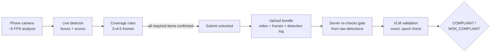

# Trustworthy Interest of Frame Extraction from Real Time Video Evidence on a ₹12,000 Phone

**What broke when we moved an object detector from a laptop to a low-end Android phone, and how we made its output trustworthy.**

*Shruti Kukreja · Applied AI Engineer · November 2026*

> This write-up describes research and engineering work done for a large Indian telecom infrastructure operator. Client names, code, model weights and site images are not published. All numbers are from our own measurements.

---

## TL;DR

- **Converting a model isn't enough. The pixels have to match too.** Changing only the image resize method moved detection scores by up to **0.15**. Only the resize that exactly matched the training pipeline passed **52 / 52** parity frames. Bilinear passed 18 / 52.
- We wrote a **bit-exact Kotlin port** of the training-time preprocessing. On the phone, **0 of 786,432** input values differed from the laptop, and on-device outputs matched the laptop (IoU 1.000, score difference < 0.0001).
- A 118 MB transformer detector (RF-DETR Small) ran at **~0.6 FPS** on a Snapdragon 730G. That result drove a split: a **lightweight CNN on the phone** for live guidance and **heavier models on the server** for the final decision.
- **The server doesn't trust the phone.** It recomputes the capture gate from raw detections and runs a VLM over the full video, including a screen-recapture spoof check, before marking anything compliant.

---

## 1. The problem

Field engineers carry out preventive maintenance at telecom tower sites, on the order of **2 lakh (200,000) site visits a month**. Each visit needs photo or video evidence of specific equipment, such as rectifier modules inside a power cabinet or surge protection devices. Today a small sample of that evidence is checked by hand.

The goal: **the phone confirms that the right equipment was properly captured while the engineer is still on site, and the system decides afterwards whether the evidence can be trusted.**

### Constraints

| Constraint | Value |
|---|---|
| Device | ₹10,000–15,000 Android phones (test device: Realme X2, Snapdragon 730G) |
| Live guidance latency | Box plus guidance within 1–2 s |
| Accuracy | False approvals are costly, so we accept slower inference for higher accuracy |
| Licensing | Permissive licences only (no AGPL, no paid licences) |
| Hardware | Must run on any CPU, GPU or NPU on non-Apple Android devices |
| Adversaries | Some users may try to game the system (old footage, filming a screen) |

---

## 2. Research questions

1. **Parity:** Does a model converted for mobile behave *identically* on the phone? If not, where does the drift come from?
2. **Latency:** What frame rate can a low-end phone actually sustain, and which runtime gets there?
3. **"Detected" vs "properly captured":** What rule turns noisy per-frame detections into a reliable "this item is covered" signal?
4. **Trust:** How do we keep a modified app or a spoofed video from producing a compliant result?

---

## 3. System overview

There are two stages, and they have different jobs:

- **Live (on the phone):** guide the engineer and confirm that each required item was captured fully and clearly. Submission stays locked until it is.
- **After upload (server):** decide. The server recomputes the gate and sends the whole video to a vision-language model (VLM) that answers structured questions, such as how many rectifier modules there are and whether the video was filmed from a screen.

---

## 4. Experiments and findings

### 4.1 Laptop-to-phone parity: preprocessing details move results a lot

**Question:** After exporting the detector (ONNX → ORT), does the phone give the same results as the laptop?

**Setup:** We fed the same decoded pixels to both pipelines and compared detections box by box. Pass criteria: same class, IoU ≥ 0.9, |Δscore| ≤ 0.02, and the top-10 raw queries within 0.02.

**Finding 1: the resize method alone changes the output.**

| Resize method | Frames passing parity (IoU ≥ 0.99, \|Δscore\| ≤ 0.01) |
|---|---|
| PIL bicubic (matches training) | **52 / 52** |
| PIL bilinear | 18 / 52 |
| OpenCV linear | 17 / 52 |

On one image the score dropped from **0.867 to 0.721** when we changed only the interpolation method.

**What we did:** We wrote a bit-exact Kotlin port of Pillow's bicubic resize and a JVM unit test that compares the phone's input tensor with the laptop's.

| Check | Result |
|---|---|
| Kotlin preprocessing vs laptop tensor | **0 of 786,432 values differ** |
| `.onnx` vs `.ort` on laptop | max score diff 6e-5, max box diff 1.1e-3 |
| On-device (Realme X2), CPU 4 threads | **PASS**: IoU 1.000, score diff < 0.0001 on every test image |
| On-device (Realme X2), XNNPACK | **PASS** |

**Takeaway:** treat preprocessing as part of the model. Store it with the model version, and require a parity test before any new runtime or device is allowed.

### 4.2 Hidden label and model behaviour

The parity work also showed problems that accuracy metrics alone would have missed:

- The model outputs **4 class logits but the label file has 3 names**. On our test set, one index never fired, which suggests an unused trailing slot. The names of the other indices still needed a labelled check.
- One class (`rm_view`) fired at **~0.96 confidence on pure noise and gradients**, with a near full-frame box. It behaves like a scene-level label rather than an object. We hid it from the overlay by default and kept it in the parity tests.

**Takeaway:** a confident output isn't necessarily a meaningful one. We moved to an explicit class map, and in production the system refuses any map that hasn't been verified.

### 4.3 Latency: the fastest hardware isn't always fastest

| Setting | Result |
|---|---|
| RF-DETR Small (FP32, 118 MB), Realme X2 | **~0.6 FPS** |
| Same model, ARM emulator on Mac, CPU 4 threads | ~260 ms inference + 38 ms preprocessing (3.2 FPS) |
| Mac server, rectifier model, CPU | p50 ≈ **85 ms** |
| Mac server, rectifier model, CoreML (GPU/Neural Engine) | p50 ≈ **137 ms** (slower) |
| Mac server, SPD model, CoreML | **Fails** |
| Batching on CPU (batch 4 vs 1) | **+20%** cost per image |

On Android, ONNX Runtime has no generic GPU backend. NNAPI is the only route to the GPU or DSP, so we benchmarked CPU (2, 4 and 8 threads), XNNPACK, NNAPI and NNAPI FP16 side by side.

**Decision:** split the work by job.
- **On the phone:** a lightweight CNN (MobileNetV3, under 10 MB, float16 TFLite) for live guidance at about 1 frame per second, giving a box, a good/bad frame signal and directions (move closer or back, too blurry, not frontal).
- **On the server:** the heavier, more accurate detectors and the VLM for the final decision.

### 4.4 Serving under load: fail fast, don't queue

For the live detector server we measured how it behaves when several phones stream at once (6 FPS per phone):

| Sessions | Achieved FPS / session | Server p50 / p95 (ms) |
|---|---|---|
| 1 | 6.0 | 85 / 94 |
| 2 | 5.8 | 247 / 327 |
| 3 | 3.8 | 412 / 477 |

A stale bounding box is worse than no box, because it guides the user to the wrong place. So the protocol:

- allows **at most 2 frames in flight** per phone (a credit system),
- **drops** frames that waited too long instead of running inference on them,
- answers `BUSY` when the queue is full, and
- sends a **"degrade" hint** (6 → 3 FPS) when the queue's p95 latency rises, then restores the rate with hysteresis.

In the saturation test this produced 15 BUSY responses, 3 degrade hints and **0 unexpected disconnects**.

### 4.5 From "detected" to "properly captured"

A single confident detection isn't evidence: the item might be cut off, blurry or visible for one frame only. An item counts as **covered** only if, on the frame analysed:

| Rule | Default |
|---|---|
| Fully in frame | Every box edge ≥ 0.02 from the image border |
| Big enough | Box area ≥ 4% of the frame |
| Sharp | Laplacian variance of the box crop above a calibrated threshold |
| Well exposed | Mean brightness 50–210, < 5% clipped pixels |
| Confident | Score ≥ the model threshold |
| **Stable** | All of the above in **≥ 3 of the last 5 frames**, with IoU ≥ 0.3 between consecutive boxes |

**Finding:** the blur metric depends on image scale. Our first threshold was 60, but real frames scored **25,000–40,000** once we fixed the metric's scale. We pinned a versioned quality metric (`q1-lapvar-256`) so thresholds can't silently drift when image size changes, and we're recalibrating them on labelled sharp and blurred frames.

### 4.6 Trust: verifying the verifier

The system has to assume that the phone's output can be wrong or tampered with:

- **The server recomputes the gate.** The app uploads its raw detection log, and the server recomputes coverage from the raw detector responses. The app's own "confirmed" claims are ignored.
- **A spoof check.** A VLM check flags videos filmed from a screen rather than at the site (target: flag ≥ 8 of 10 red-team videos).
- **No silent passes.** If any validation check fails *or errors* (for example the VLM times out or returns invalid JSON after one retry), the session is NON_COMPLIANT with the reason shown. "Couldn't check" never becomes "approved".
- **Full traceability.** Every session stores its frames, detections, pinned config, video, and the raw VLM inputs and outputs, so any decision can be audited later.

A gap review of our own code found that the server didn't yet re-check the **minimum video duration**. A modified app could therefore submit a 3-second clip with valid detections. That fix is next.

### 4.7 Real-world device issues

- **Heat:** long outdoor recordings risk thermal shutdown on cheap phones. A thermal governor drops analysis to 3 FPS at SEVERE thermal status and caps the next session at 720p.
- **Camera support varies by phone:** a camera "binding ladder" steps down through supported resolution combinations until one works on the device.
- **Emulator traps:** on Apple M4/M5 hosts, the Android emulator advertises a CPU feature that breaks ONNX Runtime, so we disable it on emulators only. The emulator's 3D virtual camera ran at ~0.2 FPS, so we switched to the plain emulated camera.

---

## 5. What didn't work, and limitations

- **A transformer detector for live use on low-end phones.** At ~0.6 FPS, RF-DETR Small was too slow for live guidance, even though its parity was perfect.
- **CoreML and CPU batching** were both slower than plain CPU in our setting.
- **Thresholds from one setup don't transfer.** The blur threshold broke as soon as the image scale changed.
- **Not yet measured end to end:** accuracy of the full phone → server → VLM pipeline on a labelled set of real site videos. The parity and latency results above are component-level.

---

## 6. Why this matters beyond this project

This work is a small, concrete instance of a broader problem: **how do you trust AI output at a scale no human team can review?**

- **Scalable oversight:** at 200,000 site visits a month, people can't check every video. The system has to show *why* it approved something (stored frames, detections and model outputs), so a human can audit any sample.
- **Adversarial robustness:** the threat model includes the user. The server recomputes the gate instead of trusting the app's claims, and spoof checks are part of the decision rule rather than an afterthought.
- **Silent distribution shift:** the largest errors came from small, invisible changes (resize method, image scale, label mapping), not from the model architecture. Parity tests and versioned preprocessing catch them before they reach users.

---

## 7. Next steps

- Run the full phone → server → VLM evaluation on a labelled set of real site videos and report precision and recall per checkpoint.
- Recalibrate the blur and exposure thresholds on labelled frames.
- Add the minimum-duration check to the server-side gate.
- Re-export detectors with a dynamic batch axis and benchmark GPU batching.
- Measure INT8 and FP16 variants of the on-device CNN against the parity suite.

---

## Appendix: engineering evidence

| Item | Value |
|---|---|
| Validation server tests | 92 passing |
| Android JVM tests | 171 (168 passed, 3 environment-gated skips) |
| Parity criteria (device) | Same class, IoU ≥ 0.9, \|Δscore\| ≤ 0.02, top-10 queries within 0.02 |
| Parity criteria (server, vs reference) | IoU ≥ 0.99, \|Δscore\| ≤ 0.01 |
| Stack | Kotlin, Jetpack Compose, CameraX, ONNX Runtime Mobile, TFLite, PyTorch, FastAPI, ffmpeg, VLM via API |

*Questions or feedback: [LinkedIn](https://linkedin.com/in/shruti-kukreja) · [GitHub](https://github.com/ShrutiKukreja)*
